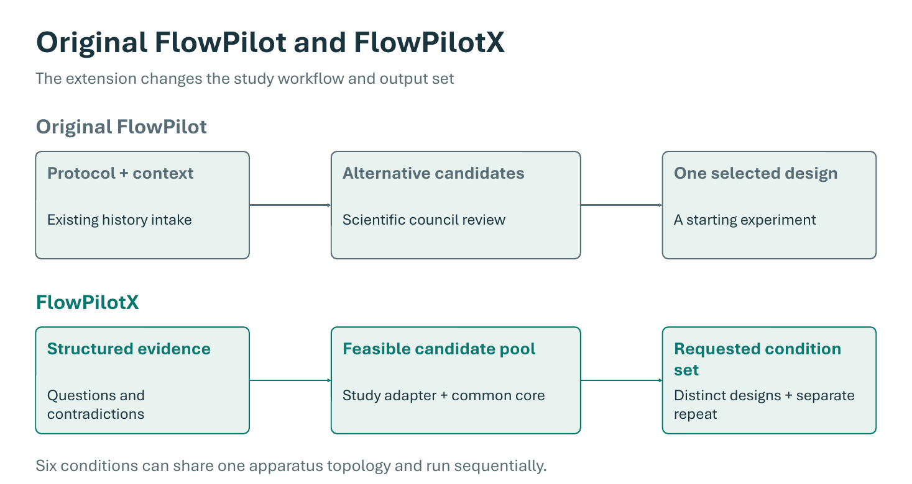
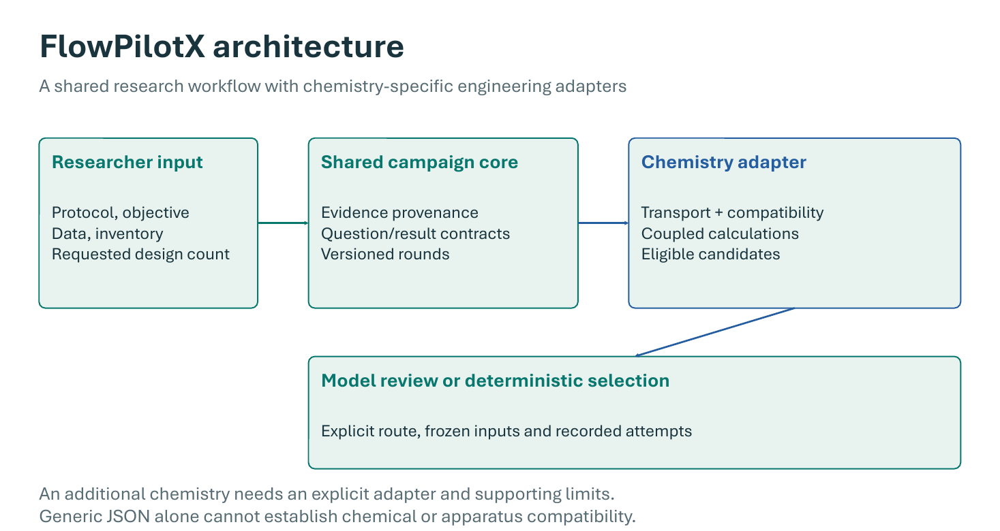

# FlowPilot and FlowPilotX — Explore

This repository brings together the original **FlowPilot** batch-to-flow design software and **FlowPilotX**, its question-led extension for coordinated experimental campaigns. FlowPilotX organizes protocols, historical evidence, equipment, scientific questions and experimental feedback into versioned rounds containing a requested number of conditions.

The complete source package includes the original retrieval, embedding, vector-store, council, engineering and diagram modules; its Streamlit and FastAPI/React interfaces; the generic FlowPilotX engine and browser GUI; and the KHU selective-oxidation adapter. Software remains in this existing project folder. Private research records and populated databases remain local and are excluded from Git.

## Two workflows

| Workflow | Entry point | What it does |
|---|---|---|
| Original FlowPilot | `baseline/flowpilot/` | Interprets a protocol, retrieves relevant process records, reviews candidate designs with specialist agents, resolves equipment and engineering settings, and produces a selected design and topology. |
| FlowPilotX | `src/flowpilotx/` | Maintains evidence, questions and inventory; selects N conditions from a reviewed pool; preserves independent repeats, rejection reasons and frozen rounds; qualifies measured feedback for the next round. |
| KHU adapter | `src/khu_sulfoxidation/` | Reconciles study sources and equipment, calculates coupled liquid/gas settings, builds conditional candidates and exports study reports and diagrams. Private inputs are required. |

## Workflow and architecture

The first figure compares the original single-design workflow with FlowPilotX's requested condition-set workflow. The second shows the shared campaign core and chemistry-specific adapter boundary. These diagrams come from explanatory slides in the project presentation; KHU-specific proposal and experimental-data slides are not included here.



*Original FlowPilot reviews alternatives for one starting design. FlowPilotX selects a requested set from a feasible candidate pool and can track an independent repeat.*



*The researcher provides the protocol, objective, evidence, inventory and requested design count. A chemistry adapter establishes feasible candidates before model review or deterministic selection.*

The FlowPilotX GUI does **not yet automatically invoke the original literature RAG and translation pipeline** to create a candidate pool for arbitrary chemistry. Both software paths are present; their interfaces and current integration limits are documented in [Architecture](docs/ARCHITECTURE.md).

## Recreate the `flent` Conda environment

The pinned environment snapshot in [`docs/environment-flent.yml`](docs/environment-flent.yml) was exported from the local `flent` environment on Linux x86_64 with Python 3.11.14. It records the Conda and pip package versions present at export time, including development and optional packages. It omits machine-specific paths and environment-variable values.

To recreate that environment on Linux:

```bash
conda env create -f docs/environment-flent.yml
conda activate flent
```

The export captures a working environment, not a minimal dependency specification. Package availability can vary by platform and over time. For a smaller installation, use the maintained project dependency files instead.

## Start FlowPilotX without private data

Use Python 3.11 or newer on Linux/macOS, or WSL on Windows:

```bash
python3 scripts/run_flowpilotx_platform.py --profile demo --port 8788
```

Open **http://127.0.0.1:8788**. The synthetic demonstration starts with six conditions and uses the Python standard library. It needs no API key, model download, retrieval database or experimental dataset. Its fictional conditions are not laboratory recommendations.

To install the Python application:

```bash
python3 -m venv .venv
source .venv/bin/activate
python -m pip install .
flowpilotx --profile demo --port 8788
```

The installed package contains the FlowPilotX GUI and study adapter. The original FlowPilot application remains a source application under `baseline/flowpilot/`, with its own dependencies. Local demo state is written to `.flowpilotx/`; `--storage` selects another state directory.

For your own study, enter the protocol and objective, supply a standardized inventory and reviewed candidate pool, add historical observations and questions, and request the number of conditions needed. Record actual conditions and separate analytical outcomes against the frozen round before selecting another round. See [Feedback](docs/FEEDBACK.md) and the synthetic schema in `examples/synthetic_campaign.json`.

## Run the original FlowPilot interfaces

From the repository root, with a virtual environment activated:

```bash
python -m pip install -r requirements-runtime.txt -r requirements-optional.txt
cd baseline/flowpilot
python -m streamlit run app.py --server.address 127.0.0.1 --server.port 8501
```

For the FastAPI/React interface, install the same Python dependencies, then build and serve the frontend. Start this block from the repository root:

```bash
cd baseline/flowpilot
npm --prefix flowpilot_webapp/frontend ci
npm --prefix flowpilot_webapp/frontend run build
python -m uvicorn flowpilot_webapp.backend.app:app --host 127.0.0.1 --port 8510
```

The frontend requires Node **20.19+ within the 20.x line, or 22.12+**. Open **http://127.0.0.1:8510**; `?demo=1` provides a UI demonstration without generating a design. Graphviz's `dot` executable is needed for the original topology renderer. Dependency installation downloads packages; it does not authorize model use.

Real translation requires your inventory, suitable literature records/index and explicit model configuration. The literature-mining, extraction and benchmark-figure modules have also been recovered from the original source. Live literature search and extraction require separately authorized provider access; Figure Studio requires owner-held figure assets and ImageMagick. See [Configuration](docs/CONFIGURATION.md).

## Retrieval and private study data

The RAG implementation is included: `retriever.py`, `embedding_engine.py`, `vector_store.py`, schemas, prompts, reranking and analogy selection. A public clone contains no populated literature corpus or Chroma database. Provide your own authorized records/index to use retrieval. Indexing and semantic retrieval can call model providers; neither is part of demo startup or installation.

The owner's local workspace also retains ignored KHU source files, inventories, historical campaigns, figures and reports. With that complete private bundle, run:

```bash
python3 scripts/run_flowpilotx_platform.py --profile khu --port 8788
```

The local `docs/NEXT_EXPERIMENT_GUIDE.md` covers continuing that study. It is intentionally absent from a public clone. An incomplete KHU bundle produces an explicit error instead of silently substituting demo evidence.

## Scientific and operational limits

FlowPilotX currently uses transparent coverage and feedback heuristics within the candidate pool. It is not Bayesian optimization, a fitted kinetic model, a calibrated information-gain estimator or a validated yield predictor. Batch durations are not flow residence times. Additional product limits must be represented and checked explicitly; the selector does not infer a complete multiobjective problem from prose.

The new gateway is opt-in and records bounded attempts without automatic retry or fallback. The preserved original agent has different provider, retry and retrieval policies; review them before live use. This repository grants no model-spending authorization, performs no automatic corpus re-embedding, and does not execute laboratory equipment. Keep all interfaces local; these are research tools without internet-service authentication.

## Verify and publish

```bash
python3 tools/run_public_tests.py
python3 tools/check_release.py
```

Public tests use synthetic fixtures and mocked transports. Actual browser, original backend, Streamlit and populated-store retrieval checks are summarized in [Runtime status](docs/RUNTIME_STATUS.md). Private study tests and selected original-component tests are additional checks with separate dependencies. Some broader original tests require external fixtures absent from the preserved snapshot; passing a focused subset does not establish a complete end-to-end validation or chemical performance.

```text
baseline/flowpilot/       Original FlowPilot software, interfaces and icons
src/flowpilotx/           Generic campaign engine and browser GUI
src/khu_sulfoxidation/    Study adapter software
examples/                Synthetic public input
tests/, scripts/, tools/ Tests, launchers and development utilities
docs/                    Public guides and ignored local study documents
data/, outputs/          Private local sources and generated work; ignored
```

This is the existing project directory, with no nested GitHub delivery copy. Follow [Publication](docs/PUBLICATION.md) to inspect the Git boundary and [NEXT_THREAD](docs/NEXT_THREAD.md) to continue development. Software and equipment-artwork licensing still require owner review; [LICENSE_STATUS.md](LICENSE_STATUS.md) grants no license.
