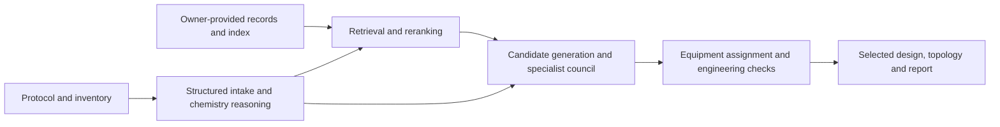
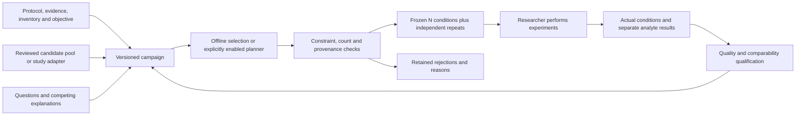

# Architecture and integration boundaries

FlowPilotX extends the research workflow around FlowPilot. Both implementations live in this repository; the original agent and the new campaign engine currently have separate entry points.

## Original FlowPilot

The source root is `baseline/flowpilot/`. `flora_translate` contains protocol schemas, chemistry interpretation, retrieval, embeddings, Chroma access, candidate review, inventory resolution, engineering and final-artifact contracts. `flora_design` supplies topology/parameter components, rendering rules and equipment icons. `flora_fundamentals` manages handbook-derived rules; `flora_optimize` contains the original optimization example. Streamlit and FastAPI/React interfaces invoke the original pipeline.

`flora_translate.main.translate` is the translation entry point. `retriever.py` combines semantic or lexical retrieval with metadata filtering, field similarity and reranking. `embedding_engine.py` and `vector_store.py` implement provider-backed summary/embedding work and persistent indexing. The original implementation includes a logged lexical fallback if semantic retrieval fails. This preserved behavior differs from FlowPilotX's bounded planning gateway and must be included in a live experiment's configuration record.

RAG software is distributed; populated records, indexes and handbook content are private local inputs. A missing corpus cannot support literature-based claims. The original `flora_scout`, `flora_prism`, PDF extractor and benchmark-figure modules are included as recovered supplemental source. Their live provider operations require separate authorization; private manuscript figures are not distributed.

## FlowPilotX campaigns

| Module in `src/flowpilotx/` | Responsibility |
|---|---|
| `campaign.py` | Immutable revisions, frozen rounds, corrections, questions and concurrency guards |
| `evidence.py` | Source identity, analytical qualifiers, original values and explicit missingness |
| `inventory.py` | Structured equipment, counts, units and constraints |
| `selection.py` | Requested counts, repeats, coverage/diversity, feedback eligibility and rejection records |
| `gateway.py` | Opt-in Qwen-compatible planning, attempt ledger, no automatic retry or fallback |
| `review_import.py` | Completed model-review import and hash-bound figure access |
| `server.py`, `gui/` | Local browser interface and campaign/result operations |
| `demo.py` | Synthetic data-free example |

The selector works within supplied candidates. It does not automatically call the original RAG/translation pipeline, infer arbitrary mechanisms, synthesize every apparatus or estimate quantitative kinetics from batch data. A future connection must explicitly turn reviewed original-agent outputs into candidate and evidence contracts, with source identities, routing and computational costs recorded.

## Study adapters and feedback

`src/khu_sulfoxidation/` supplies the selective-oxidation adapter. It preserves overlapping source exports without double-counting, keeps batch and flow observations distinct, tracks separate chemical outcomes, reconciles apparatus and computes coupled gas/liquid settings. Its figures reuse original FlowPilot artwork and rendering components. Private model packages can be imported into separate immutable GUI campaigns without dispatching new calls.

Candidates carry proposed parameters, equipment assignments, questions, source references and unresolved conditions. Actual observations carry measured controls, analytical methods and outcomes separately from calculated indices and assumptions. Only qualified, comparable, nonsuperseded flow observations can affect numerical feedback. Excluded or corrected observations remain traceable.

Exploration and optimization currently use transparent heuristics. Neither the generic selector nor the original optimization example establishes a validated constrained Bayesian optimizer for arbitrary selective chemistry. Batch evidence, values above 100 percent and missing fields remain as reported; they are not silently normalized or reinterpreted as flow outcomes.

Both interfaces are local research applications. FlowPilotX uses POSIX file locking and JSON state; it is not an authenticated multiuser service or laboratory-control system.
